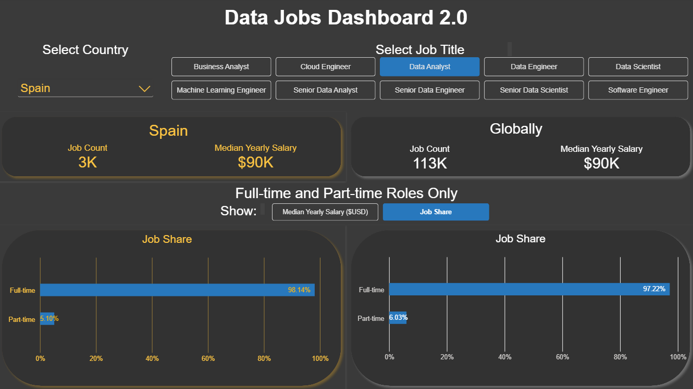

# Data Jobs Dashboard v2 with Power BI

## Introduction

This dashboard was created in the context of the [**Power BI for Data Analytics**](https://www.lukebarousse.com/powerbi) course.

This project is a one-page interactive Power BI dashboard designed for data professionals and job seekers who want to understand the job market for their role in a specific country compared to the rest of the world. It answers three key questions:
1. *How many postings are there for my role in this country compared to globally?*
2. *How does the median yearly salary compare?*
3. *How do salary and availability differ between full-time and part-time roles?*

Side-by-side KPI cards show job count and median yearly salary for the selected country and globally, while bar charts break down full-time and part-time roles, with a toggle to switch between median salary and each schedule type's share of postings.

The data powering the dashboards comes from a *real-world dataset of job postings for various data-related roles from 2023 through August 2026*. 

## Skills Showcased

- **Dashboard design**:
    - Defined the target user and key questions before building.
    - Side-by-side comparison layout: selected country vs. global.
    - Consistent color coding (orange for the selected country, white for global), typography and alignment
    - Equal axis scales and clear. labeling (currency, schedule types shown, notes for missing data).
- **Data Transformation (ETL) with Power Query**: In this project I utilised the queries developed in the [previous project](../Data_Jobs_v1/README.md), and on top of them I added dimension tables for Country and Schedule Type by referencing existing queries. Several data cleaning operations were performed, such as Trim, Remove Duplicates and blank filtering. 
- **Data Modeling**:
    - Star-schema relationships between fact, bridge and dimension tables.
    - Configured cardinality (one-to-many) and cross-filter direction (Single / Both).
    - Handled a bridge table where a job posting can have several schedule types.
- **DAX Fundamentals**:
    - Measures for job count, median yearly salary, job share and postings with salary data
    - Functions: `CALCULATE`, `ALLSELECTED`, `DIVIDE`, `SELECTEDVALUE`, `SWITCH`, `ISBLANK`, `ISFILTERED`.
    - Text measures for dynamic headers and context-aware notes for missing data.
    - Measure-driven axis range that adapts to the selected measure.
- **Visualisations Utilised**:
    - **Core Charts**:
        - Bar charts comparing schedule types, with data labels and tooltips.
        - "Show items with no data" for consistent categories across both halves.
    - **Cards**:
        - KPI cards for job count and median yearly salary (country and global).
        - Dynamic text cards for the country header and missing-data notes.
- **Interactive Features**
    - **Slicers**:
        - Dropdown country slicer with a preselected default value.
        - Edit interactions so the country filter applies only to the country-specific half of the page.
    - **Buttons**:
        - Button slicer for job title selection with state-based formatting (default / selected).
        - Field parameter button slicer to toggle between median salary and job share.

## Dashboard overview

The dashboard is organised top to bottom: filters for country and job title at the top, followed by a side-by-side comparison of the selected country (in orange) and global figures (in white).

Each half shows KPI cards for job count and median yearly salary.

Bottom part of the dashboard contains bar charts that break down full-time and part-time roles, with a "Show" toggle to switch between median salary and job share. Dynamic headers and notes update with every selection, for example naming the selected country and flagging when a schedule type has no data, so the comparison always stays clear and easy to read.

## Conclusion
This dashboard (Version 2.0) turns a large dataset of job postings into a clear comparison of how a selected country's data job market stacks up against global figures. For example, it shows that the median yearly salary for **Data Analyst** in **Spain** is **$90K**, which is in line with the global offering, while full-time roles make up almost all postings in both cases. Note, that Job Share for full-time and part-time roles can add up to more than 100%.[^1] It helps **job seekers** make informed decisions about which data role to target and where, based on job availability, salary levels and schedule type.

[^1]: A job posting can list more than one schedule type, so it may be counted in both groups.
