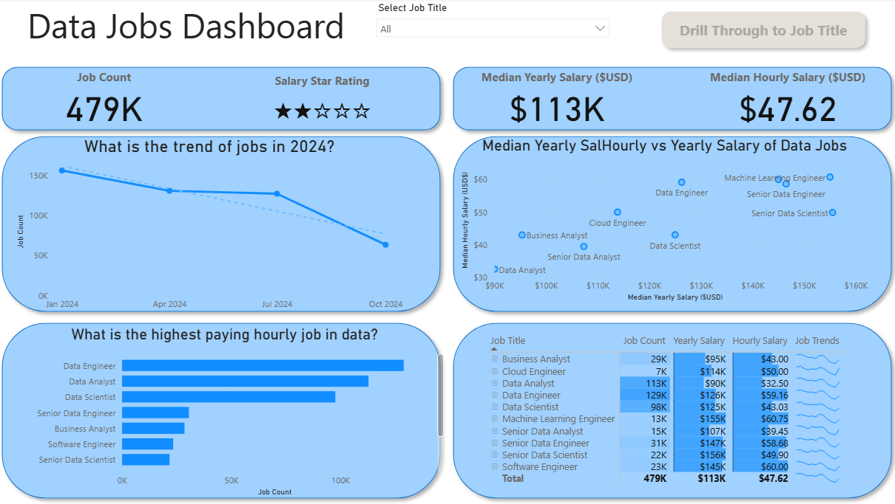
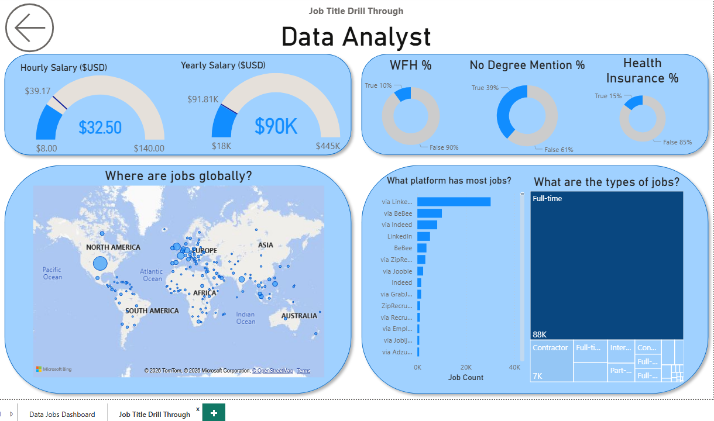

# Data Jobs Dashboard with Power BI

## Introduction

These dashboards were created in the context of the [**Power BI for Data Analytics**](https://www.lukebarousse.com/powerbi) course. They facilitate job searching for professionals working in the fields of data science, data engineering, and data analytics. The data powering the dashboards comes from a *real-world dataset of job postings for various data-related roles from 2024 through December 2025*. This project provides a single, easy-to-use interface to explore data jobs market trends and compensation.

## Skills Showcased

- **Data Transformation (ETL) with Power Query**: Cleaned, shaped, and prepared the raw data for analysis by handling blanks, changing data types, and creating new columns.
- **Implicit Measures**: Formulated measures to derive key insights and KPIs such as `Median Yearly Salary` or `Job Count`.
- **Core Charts**: Utilised **Column, Bar, Line**, and **Area Charts** to compare job counts and track trends over time.
- **Geospatial Analysis**: Leveraged **Map Charts** to visualise the global distribution of jobs.
- **KPI Indicators & Tables**: Used **Cards** to display key metrics and **Tables** to provide granular, sortable data.
- **Dashboard Design**: Designed an intuitive and visually appealing layout, exploring both common and uncommon chart types to best tell the data story.
- **Interactive Reporting**:
    - **Slicers**: To dynamically filter the report by `Job Title`.
    - **Buttons & Bookmarks**: To create a seamless navigation experience.
    - **Drill-Through**: To navigate from a high-level summary to a contextual, detailed view.

## Dashboard overview

### Page 1: High-Level Market View

The main dashboard contains an overview of the job market. It showcases KPIs such as `Job Count`, `Median Yearly Salary ($USD)`, and top job titles.

### Page 2: Job Title Drill Through

This is the drill through page. From the main dashboard, you can dive deeper into this view to get specific details for a selected job title. This page shows salary ranges and supplementary information about job postings, such as whether there are mentions of health insurance, a degree requirement, or remote work. 
Additionally, the locations of the jobs can be explored on a map. Finally, the job posting platforms and different job types are summarised.

## Conclusion

In this project, we used Power BI to create a powerful tool for data job seekers. It allows users to access the latest collection of job postings through a user-friendly interface. Users can gain a better understanding of the job market by looking at the KPIs and filtering, slicing, and drilling through the data across different dimensions.